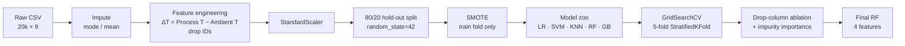
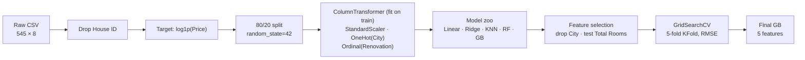

# Supervised Learning: Predictive Maintenance & House-Price Regression

Two end-to-end supervised learning studies built with scikit-learn. Each one runs the same experimental protocol: data audit, EDA, leakage-aware preprocessing, a model zoo compared against a trivial baseline, cross-validated hyperparameter search, and ablation-based feature attribution.

| Study | Task | Data | Best model | Headline result (held-out test set) |
|---|---|---|---|---|
| [`classification.ipynb`](classification.ipynb) | Binary fault detection (predictive maintenance) | 20,000 machine readings, 3.4% positive class | Random Forest + SMOTE | **Fault recall 0.96**, precision 0.83, F1 0.89, ROC-AUC ≈ 0.996 |
| [`Regression.ipynb`](Regression.ipynb) | House sale price regression | 545 properties, 5 US cities | Gradient Boosting on log-price | **R² 0.57**, RMSE 0.29 (log-$), vs. 0.00 / 0.44 for a mean baseline |

**Stack:** Python · scikit-learn · imbalanced-learn (SMOTE) · pandas · NumPy · matplotlib · seaborn

---

## Highlights

- Built a **predictive-maintenance classifier** on a heavily imbalanced dataset (29:1). It catches **96% of faulty machines** on unseen data, where a majority-class baseline that scores 97% accuracy catches none.
- Applied **SMOTE to the training fold only** and chose models on minority-class recall and F1 instead of accuracy, since accuracy hides failure on the rare class here.
- **Engineered a physics-motivated feature** (process − ambient temperature, ΔT). Ablation shows it is responsible for a **0.10 F1 gain**.
- Ran **drop-column ablations** alongside impurity-based importances. Torque and tool wear were the strongest fault predictors, and product-quality grade added nothing.
- For regression, **log-transformed a right-skewed target**, built a **`ColumnTransformer` pipeline** (scaling, one-hot, ordinal encoding) fit on training data only, and tuned Ridge and Gradient Boosting with 5-fold `GridSearchCV`.
- Reported **negative results** too. An engineered "Total Rooms" feature and location one-hot features both *reduced* R², so they were left out of the final model.

---

## Study 1: Machine-Fault Classification (`classification.ipynb`)

### Problem

Predict whether a factory machine is **working (0)** or **faulty (1)** from operational sensor readings. In maintenance, a missed fault (false negative) costs far more than a false alarm, so **recall on the fault class is the main metric**, with F1 used to keep precision reasonable.

### Data

`datasets/factory_data.csv`: 20,000 rows × 9 columns. Features are product quality (L/M/H), ambient and process temperature (°C), rotation speed (rpm), torque (Nm) and tool wear (min).

| Issue found during audit | Handling |
|---|---|
| Missing values: Quality (991), Process T (400), Rotation Speed (1,188) | Mode imputation for the ordinal feature, mean imputation for the continuous ones |
| IQR outliers: Rotation Speed (955), Torque (138) | **Kept.** They are physically plausible readings and probably carry failure signal |
| Class imbalance: 96.6% / 3.4% | SMOTE on the training split only (15,459 : 541 → 15,459 : 15,459) |
| Ambient T ↔ Process T correlation ρ = 0.87; Torque ↔ Rotation Speed ρ = −0.85 | Merged the temperatures into ΔT; kept torque and speed (see ablation) |

### Pipeline



### Model comparison (default hyperparameters, test set, fault class)

| Model | Precision | Recall | F1 | Accuracy |
|---|---:|---:|---:|---:|
| Majority-class baseline | 0.00 | 0.00 | 0.00 | 0.97 |
| Logistic Regression | 0.14 | 0.84 | 0.23 | 0.81 |
| SVM (RBF) | 0.32 | 0.94 | 0.48 | 0.93 |
| K-Nearest Neighbours | 0.48 | 0.91 | 0.63 | 0.96 |
| Gradient Boosting | 0.36 | 0.93 | 0.52 | 0.94 |
| **Random Forest** | **0.85** | **0.93** | **0.89** | **0.99** |

Every non-trivial model reaches high recall once SMOTE is applied. They differ mainly in **precision**: only the bagged tree ensemble keeps false alarms low. This fits the non-linear, interaction-heavy decision boundary visible in the torque-vs-speed pairplot.

### Tuning

5-fold stratified `GridSearchCV` over `n_estimators`, `max_depth`, `min_samples_split`, `min_samples_leaf` and `max_features` (72 configurations). Best: `n_estimators=250, max_depth=None, max_features="sqrt"`. Test F1 improved slightly, from 0.89 to 0.90, so the default RF was already close to its ceiling on this feature set.

### Feature attribution (drop-column ablation, tuned RF)

| Feature removed | Fault precision | Fault recall | Fault F1 | ΔF1 vs. full model (0.90) |
|---|---:|---:|---:|---:|
| Torque (Nm) | 0.68 | 0.84 | 0.75 | **−0.15** |
| ΔT (°C) | 0.71 | 0.93 | 0.80 | **−0.10** |
| Tool Wear (min) | 0.76 | 0.88 | 0.81 | −0.09 |
| Rotation Speed (rpm) | 0.80 | 0.94 | 0.87 | −0.03 |
| Quality (L/M/H) | 0.85 | 0.96 | 0.90 | ±0.00 |

The impurity-based importances give the same top features (torque, speed, tool wear, ΔT) and rank Quality last. Quality was therefore dropped.

### Final model

Random Forest (tuned) on {ΔT, Torque, Rotation Speed, Tool Wear}:

| Fault precision | Fault recall | Fault F1 | Accuracy | ROC-AUC |
|---:|---:|---:|---:|---:|
| 0.83 | **0.96** | 0.89 | 0.99 | ≈ 0.996 |

Of the 137 faulty machines in the test set, about 131 are flagged, and roughly one alert in six is a false alarm.

---

## Study 2: House-Price Regression (`Regression.ipynb`)

### Problem

Predict the sale price of a house from its size, layout, furnishing status and city.

### Data

`datasets/housing_price_data.csv`: 545 rows × 8 columns, with no missing values or duplicates. Price ranges from $175k to $1.33M (median $434k) and is clearly right-skewed.

### Pipeline



Design choices:
- **Log target.** `log1p(Price)` removes most of the right skew, so squared-error losses are not dominated by a few $1M+ properties. All metrics below are in log-dollar space. An RMSE of 0.29 is roughly a ±30% multiplicative error.
- **Encoding by measurement level.** City is nominal (one-hot). Renovation status is ordinal (`unfurnished < semi-furnished < furnished`).
- **Leakage control.** The scaler and encoders are fit inside a `ColumnTransformer` on the training split only.

### Model comparison (test set, log-price)

| Model | MAE | RMSE | R² |
|---|---:|---:|---:|
| Mean baseline (`DummyRegressor`) | 0.36 | 0.44 | 0.00 |
| K-Nearest Neighbours | 0.26 | 0.33 | 0.42 |
| Random Forest | 0.23 | 0.31 | 0.52 |
| Linear Regression | 0.25 | 0.30 | 0.52 |
| Ridge Regression | 0.25 | 0.30 | 0.52 |
| Gradient Boosting | 0.24 | 0.30 | 0.54 |

Linear models come within 0.02 R² of boosted trees, which suggests the signal is **mostly linear** in log-price. The learning curves show small train/validation gaps, so the ceiling comes from the **features available (bias)** rather than from overfitting (variance).

### Feature-set experiments

| Feature set | GB R² | Outcome |
|---|---:|---|
| All features incl. City one-hot | 0.54 | Baseline |
| Drop City (near-zero / negative correlation with price) | **0.55** | Kept |
| Replace Bedrooms + Toilets with engineered `Total Rooms` | 0.53 | **Rejected.** Merging them lost information |

### Tuning & final model

5-fold `GridSearchCV` (scoring = RMSE). Ridge selected `alpha=10`. Gradient Boosting selected `learning_rate=0.1, max_depth=2, n_estimators=50, subsample=0.8, min_samples_split=5`. That is a shallow, heavily regularised ensemble, as you would expect with n = 436 training rows.

| Final model | MAE | RMSE | R² |
|---|---:|---:|---:|
| Tuned Gradient Boosting | 0.23 | **0.29** | **0.57** |
| Tuned Ridge | 0.24 | 0.30 | 0.53 |

**Feature importance (GB):** House Area 0.59 › Toilets 0.18 › Renovation Status 0.11 › Bedrooms 0.07 › Stories 0.05. Floor area explains most of the model's splits.

---

## Discussion & Limitations

These are documented in the interest of rigour and point to the next iteration of the work:

- **Scaling before the split (classification).** The `StandardScaler` is fit on the full dataset before the train/test split. With 20k rows the leakage is small, but a `Pipeline`/`imblearn.Pipeline` wrapping scaler → SMOTE → model would be strictly correct.
- **Unstratified hold-out.** The classification split is not stratified. The test set happens to contain 137 positives (3.4%), but `stratify=y` would make that guaranteed.
- **SMOTE on an ordinal feature.** SMOTE interpolates continuous values, which creates fractional or missing "Quality" levels. These were re-imputed. SMOTE-NC or dropping Quality earlier (as the ablation later supports) would be cleaner.
- **CV metric choice.** The grid search optimised `recall_weighted` on a balanced (SMOTE) training set, which differs from the deployment objective (minority-class recall on imbalanced data). Scoring on minority-class F2 inside a resampling pipeline would match it better.
- **Regression drop-column test.** The ablation loop in the regression notebook re-fits on the full feature matrix without removing the column, so it reports zero change for every feature. The ranking reported above therefore relies on GB impurity importance and the correlation analysis.
- **Small-sample variance (regression).** With 545 rows, single-split R² differences of ±0.02 are within noise. Repeated K-fold CV with confidence intervals would be needed to claim that GB actually beats Ridge.
- **Explained variance ceiling.** R² ≈ 0.57 means roughly 40% of log-price variance is unexplained. Lot size, age, neighbourhood quality and transaction date are likely missing drivers.

---

## Repository Structure

```
supervised-learning/
├── classification.ipynb        # Study 1: machine-fault detection
├── Regression.ipynb            # Study 2: house-price regression
├── datasets/
│   ├── factory_data.csv        # 20,000 machine sensor readings
│   ├── housing_price_data.csv  # 545 property sales
│   └── meta data.txt           # Column descriptions for both datasets
├── Slides.pptx                 # Presentation of methods and results
└── requirements.txt            # Pinned dependencies
```

## Reproducing the Results

```bash
git clone https://github.com/pufferfish3e/supervised-learning.git
cd supervised-learning
python -m venv .venv && source .venv/bin/activate
pip install -r requirements.txt jupyter
jupyter notebook
```

Open either notebook and choose **Run All**. All splits, SMOTE and models use `random_state=42`, so the tables above should reproduce, give or take small library-version differences (versions are pinned in `requirements.txt`).

## Author

**Kendrick Slamat**: Diploma in Applied AI & Analytics, AI & Machine Learning module (CA1).
