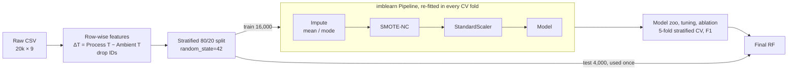
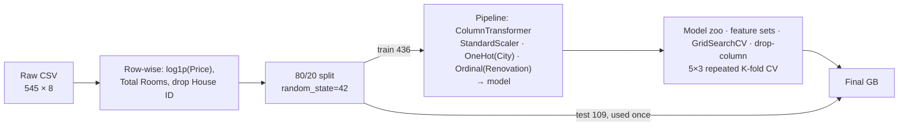

# Supervised Learning: Predictive Maintenance & House-Price Regression

Two end-to-end supervised learning studies built with scikit-learn. Each one runs the same experimental protocol: data audit, EDA, a **leakage-free pipeline** (every fitted step lives inside the cross-validation folds), a model zoo compared against a trivial baseline, cross-validated hyperparameter search, ablation-based feature attribution, and a single final evaluation on a held-out test set.

| Study | Task | Data | Best model | Headline result (held-out test set, used once) |
|---|---|---|---|---|
| [`classification.ipynb`](classification.ipynb) | Binary fault detection (predictive maintenance) | 20,000 machine readings, 3.4% positive class | Random Forest + SMOTE-NC | **Fault recall 0.95**, precision 0.86, F1 0.90, ROC-AUC 0.998 |
| [`Regression.ipynb`](Regression.ipynb) | House sale price regression | 545 properties, 5 US cities | Gradient Boosting on log-price | **R² 0.57** (CV 0.56 ± 0.05), median error 17.7% of price |

**Stack:** Python · scikit-learn · imbalanced-learn (SMOTE-NC, `imblearn.Pipeline`) · pandas · NumPy · matplotlib · seaborn

---

## Highlights

- Built a **predictive-maintenance classifier** on a heavily imbalanced dataset (29:1). It catches **95% of faulty machines** on unseen data, where a majority-class baseline that scores 97% accuracy catches none.
- Put **imputation → SMOTE-NC → scaling → model** in one `imblearn` pipeline, so missing-value statistics, synthetic samples and scaling factors are learned only from training folds. SMOTE-NC keeps the ordinal quality grade on its real levels.
- Chose every model, hyperparameter and feature **by stratified cross-validation on the training set**, scored on minority-class F1. The test set was used exactly once.
- **Engineered a physics-motivated feature** (process − ambient temperature, ΔT). The drop-column ablation shows it is the single most important feature (**−0.16 F1** when removed).
- For regression, **log-transformed a right-skewed target**, compared models with **5×3 repeated K-fold CV** to measure fold-to-fold noise, and showed that the test R² (0.571) matches the cross-validated estimate (0.563).
- Reported **negative results** too. An engineered "Total Rooms" feature lowered R² for every model, and hyperparameter tuning barely moved the Random Forest (F1 0.829 → 0.830).

---

## Study 1: Machine-Fault Classification (`classification.ipynb`)

### Problem

Predict whether a factory machine is **working (0)** or **faulty (1)** from operational sensor readings. A missed fault costs far more than a false alarm, so the models are judged on the **faulty class**: F1 is the main metric, with recall and precision reported alongside.

### Data

`datasets/factory_data.csv`: 20,000 rows × 9 columns. Features are product quality (L/M/H), ambient and process temperature (°C), rotation speed (rpm), torque (Nm) and tool wear (min).

| Issue found during audit | Handling |
|---|---|
| Missing values: Quality (991), Process T (400), Rotation Speed (1,188) | Mode / mean imputation, **fitted inside the pipeline** on training folds only |
| IQR outliers: Rotation Speed (955), Torque (138) | **Kept.** They are physically plausible readings and probably carry failure signal |
| Class imbalance: 96.6% / 3.4% | **SMOTE-NC** inside the pipeline (training folds only); stratified train/test split |
| Ambient T ↔ Process T correlation ρ = 0.87; Torque ↔ Rotation Speed ρ = −0.85 | Merged the temperatures into ΔT; kept torque and speed (see ablation) |

### Pipeline



### Model comparison (5-fold stratified CV on the training set, faulty class)

| Model | Precision | Recall | F1 |
|---|---:|---:|---:|
| Logistic Regression | 0.135 | 0.790 | 0.230 |
| SVM (RBF) | 0.272 | 0.893 | 0.417 |
| K-Nearest Neighbours | 0.339 | 0.871 | 0.488 |
| Gradient Boosting | 0.334 | **0.917** | 0.490 |
| **Random Forest** | **0.775** | 0.891 | **0.829** |

With SMOTE, every model reaches high recall. The difference is in **precision**: the other models raise two to six false alarms per real fault, while Random Forest raises fewer than one per three. Its learning curve is still rising at the full training size (validation F1 0.44 → 0.83), while Logistic Regression stays flat at 0.23, which points to a non-linear, interaction-heavy decision boundary (visible in the torque-vs-speed pairplot).

### Tuning

5-fold stratified `GridSearchCV` over `n_estimators`, `max_depth`, `min_samples_split`, `min_samples_leaf` and `max_features` (72 configurations), with the full pipeline in each fold and faulty-class F1 as the score. Best: `n_estimators=200, max_depth=None, max_features="sqrt"`. CV F1 moved only from 0.829 to 0.830, so the default RF was already at its ceiling on this feature set.

### Feature attribution (drop-column ablation, tuned RF, 5-fold CV)

| Feature removed | Fault precision | Fault recall | Fault F1 | ΔF1 vs. all features (0.830) |
|---|---:|---:|---:|---:|
| ΔT (°C) | 0.548 | 0.858 | 0.669 | **−0.161** |
| Tool Wear (min) | 0.602 | 0.799 | 0.687 | **−0.143** |
| Torque (Nm) | 0.617 | 0.790 | 0.693 | **−0.137** |
| Rotation Speed (rpm) | 0.729 | 0.876 | 0.796 | −0.034 |
| Quality (L/M/H) | 0.740 | 0.895 | 0.810 | −0.019 |

Every feature helps, so all five are kept. Impurity-based importances rank them differently (Torque 0.32 › Speed 0.29 › Tool Wear 0.24 › ΔT 0.14 › Quality 0.02). Impurity importance splits the credit between the correlated torque and speed features, while the ablation shows that no other feature can stand in for ΔT.

### Final model (test set, evaluated once)

| Fault precision | Fault recall | Fault F1 | Accuracy | ROC-AUC |
|---:|---:|---:|---:|---:|
| 0.86 | **0.95** | 0.90 | 0.99 | 0.998 |

About 129 of the 136 faulty test machines are flagged, and roughly one alert in seven is a false alarm.

---

## Study 2: House-Price Regression (`Regression.ipynb`)

### Problem

Predict the sale price of a house from its size, layout, furnishing status and city.

### Data

`datasets/housing_price_data.csv`: 545 rows × 8 columns, with no missing values or duplicates. Price ranges from $175k to $1.33M (median $434k) and is clearly right-skewed.

### Pipeline



Design choices:
- **Log target.** `log1p(Price)` removes most of the right skew, so squared-error losses are not dominated by a few $1M+ properties. Metrics are reported in log-dollar space; an RMSE of 0.29 is roughly a ±30% multiplicative error.
- **Encoding by measurement level.** City is nominal (one-hot). Renovation status is ordinal (`unfurnished < semi-furnished < furnished`).
- **Repeated CV.** With only 436 training rows, a single split is noisy. Reporting the standard deviation of R² across 15 folds shows which differences are real.

### Model comparison (5×3 repeated K-fold CV on the training set, log-price)

| Model | MAE | RMSE | R² (± std) |
|---|---:|---:|---:|
| Mean baseline (`DummyRegressor`) | 0.283 | 0.354 | −0.04 ± 0.04 |
| K-Nearest Neighbours | 0.197 | 0.251 | 0.47 ± 0.09 |
| Random Forest | 0.188 | 0.242 | 0.51 ± 0.06 |
| Linear Regression | 0.190 | 0.240 | 0.52 ± 0.05 |
| Ridge Regression | 0.189 | 0.240 | 0.52 ± 0.05 |
| **Gradient Boosting** | **0.183** | **0.234** | **0.54 ± 0.06** |

Gradient Boosting leads by about 0.02 R², which is smaller than the fold-to-fold standard deviation, so the signal is **mostly linear** in log-price. The learning curves agree: the linear models plateau with a small train/validation gap (limited by bias), Random Forest overfits (train MSE about 0.01 against validation about 0.06), and Gradient Boosting's validation error is still falling.

### Feature-set experiments (CV R²)

| Feature set | GB | Linear / Ridge | RF | Outcome |
|---|---:|---:|---:|---|
| All features incl. City one-hot | 0.542 | 0.520 | 0.511 | Baseline |
| Drop City (train-set correlation with price −0.03 to 0.07) | **0.546** | **0.530** | 0.475 | **Kept** |
| Drop City, `Total Rooms` replaces Bedrooms + Toilets | 0.527 | 0.505 | 0.452 | **Rejected.** Merging them lost information |

### Tuning & final model

5-fold `GridSearchCV` (scoring = RMSE) with the pipeline inside each fold. Ridge selected `alpha=10`. Gradient Boosting selected `learning_rate=0.1, max_depth=2, n_estimators=50, subsample=0.8, min_samples_split=5`: a shallow, heavily regularised ensemble, as you would expect with 436 training rows.

| Model (CV) | MAE | RMSE | R² |
|---|---:|---:|---:|
| Ridge, default → tuned | 0.187 → 0.187 | 0.238 → 0.237 | 0.530 → 0.531 |
| Gradient Boosting, default → tuned | 0.183 → **0.179** | 0.233 → **0.229** | 0.546 → **0.563** |

**Final test-set result (tuned GB, evaluated once):** R² **0.571**, RMSE 0.288, MAE 0.231 (mean baseline: R² −0.005, RMSE 0.440). In dollars: MAE ≈ **$113k**, and the median house is predicted within **17.7%** of its sale price.

**Feature attribution.** Drop-column CV RMSE increase: House Area +0.043 › Renovation Status +0.015 › Toilets +0.014 › Stories +0.003 › Bedrooms +0.003. GB impurity importance: House Area 0.59 › Toilets 0.18 › Renovation 0.11 › Bedrooms 0.07 › Stories 0.05. Both methods put floor area far ahead of everything else, and every feature increases the error when removed.

---

## Discussion & Limitations

- **Small test sets.** The classification test set has only 136 faulty machines, so its F1 (0.90) carries real sampling noise. It is higher than the CV estimate (0.83) but consistent with it. The regression test set has 109 houses.
- **Explained-variance ceiling (regression).** R² ≈ 0.57 leaves about 43% of log-price variance unexplained. Lot size, building age, neighbourhood quality and sale date are likely missing drivers, and the learning curves suggest that more data would mainly help the boosted model.
- **Threshold choice (classification).** Results use the default 0.5 probability threshold. In a real deployment the threshold should be set from the cost of a missed fault compared with a false alarm, using the precision–recall curve on validation data.
- **Ordinal Quality under SMOTE-NC.** SMOTE-NC treats Quality as nominal when it generates synthetic machines. That keeps the values valid (L/M/H), but it ignores the L < M < H ordering.
- **Reproducibility.** All splits and models use `random_state=42`. Results can still shift slightly with library versions; the versions used are pinned in `requirements.txt`.

---

## Repository Structure

```
supervised-learning/
├── classification.ipynb        # Study 1: machine-fault detection
├── Regression.ipynb            # Study 2: house-price regression
├── datasets/
│   ├── factory_data.csv        # 20,000 machine sensor readings
│   ├── housing_price_data.csv  # 545 property sales
│   └── meta data.txt           # Column descriptions for both datasets
├── Slides.pptx                 # Presentation of methods and results
└── requirements.txt            # Pinned dependencies
```

## Reproducing the Results

```bash
git clone https://github.com/pufferfish3e/supervised-learning.git
cd supervised-learning
python -m venv .venv && source .venv/bin/activate
pip install -r requirements.txt jupyter
jupyter notebook
```

Open either notebook and choose **Run All**. The regression notebook runs in about 2 minutes. The classification notebook takes longer (about 15 minutes on 4 cores), because the grid search and ablation re-fit the full SMOTE pipeline in every fold.

## Author

**Kendrick Slamat**: Diploma in Applied AI & Analytics, AI & Machine Learning module (CA1).
